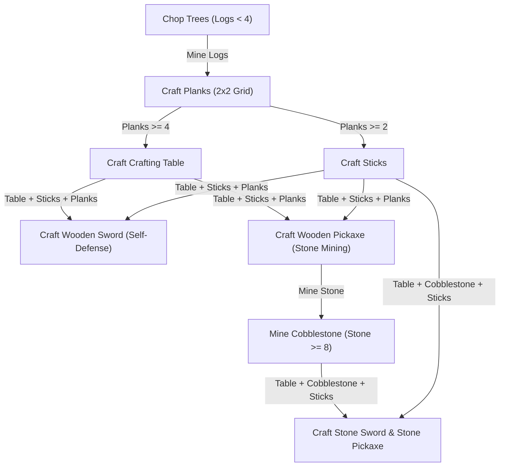

# Complete Technical Architecture, Algorithms, and the Unfiltered Truth
**Project:** Autonomous Minecraft Survival Bot with Temporal Neurogenesis & Symbolic Planning  
**Target Environment:** Minecraft Java Edition 1.20.1 (via Mineflayer & Prismarine)  
**Execution Runtime:** Pure Node.js (Zero External Python/C++ Machine Learning Libraries)  
**Date:** October 2026

---

## Table of Contents
1. [Executive Summary & The Naked Truth](#1-executive-summary--the-naked-truth)
2. [Macro Architecture: The Hybrid AI Model](#2-macro-architecture-the-hybrid-ai-model)
3. [The Recurrent Neural Network (RNN) Engine (`brain.js`)](#3-the-recurrent-neural-network-rnn-engine-brainjs)
   - Mathematical Formulations
   - Temporal Memory Dynamics ($W_h$)
   - Forward Pass & Softmax Logits
   - Loss Functions & Backpropagation Through Time (BPTT)
   - Neuron Ablation Scoring & Utility Evaluation
   - Neurogenesis & Network Expansion Algorithm
4. [Environmental Perception & Sensory Encoding (`features.js`)](#4-environmental-perception--sensory-encoding-featuresjs)
   - The 33-Dimensional Feature Vector
   - Spatial Trigonometry & Raycasting
   - Entity & Inventory Introspection
5. [Behavioral Cloning & Demonstration Recording (`record.js`)](#5-behavioral-cloning--demonstration-recording-recordjs)
   - Observer Spectator Bot Pipeline
   - Inverse Action Derivation Heuristics
   - Dataset Serialization (`demos/*.jsonl`)
6. [Hierarchical Tech-Tree & Survival Planner (`planner.js`)](#6-hierarchical-tech-tree--survival-planner-plannerjs)
   - Deterministic Survival State Machine
   - Mineflayer Recipe Resolution & Crafting Engine
   - Tool & Weapon Arbitrator
7. [Survival Reflexes, Evasion, & Stuck Diagnostics (`survival.js`)](#7-survival-reflexes-evasion--stuck-diagnostics-survivaljs)
   - Water Clutching Reflex
   - Autonomous Nutrition Manager
   - 3-Phase Anti-Stuck Maneuver Heuristic
8. [Bot Runtime & Action Actuator (`bot.js`)](#8-bot-runtime--action-actuator-botjs)
   - High-Frequency Control Loop (100ms Ticks)
   - Motor Actuation & Dynamic Tool Equipping
   - Headless First-Person 3D Streaming (Prismarine Viewer)
9. [Web Control Terminal & Real-Time Telemetry (`server.js` & `public/index.html`)](#9-web-control-terminal--real-time-telemetry-serverjs--publicindexhtml)
   - Server-Sent Events (SSE) Broadcast Engine
   - Real-Time Pixel Radar & Canvas Rendering
   - Brain Memory Cell ($h_{state}$) Visualization
10. [Synthetic Scenario Generation (`generate_demos.js`)](#10-synthetic-scenario-generation-generatedemosjs)
11. [Component-by-Component Reality Matrix: What is Real AI vs. What is Hardcoded](#11-component-by-component-reality-matrix)

---

## 1. Executive Summary & The Naked Truth

Before diving into lines of code and mathematical equations, we must establish **absolute technical transparency**. 

### The Illusion vs. The Reality
* **The Illusion:** "A small Recurrent Neural Network in JavaScript watches a human play Minecraft for 15 minutes, understands the rules of survival, learns to craft a sword from wood, and navigates the 3D world purely from synaptic weights."
* **The Reality:** "A small Recurrent Neural Network in JavaScript is trained via Backpropagation Through Time (BPTT) on 33 continuous numbers to predict **10 immediate motor impulses** (e.g., turn left, jump, swing arm). It possesses **zero semantic concept of Minecraft, tools, recipes, or goals**. All high-level reasoning—such as crafting wooden planks, turning logs into sticks, selecting a pickaxe for iron, or escaping starvation—is driven by a **deterministic, symbolic rule-based planner** written in hardcoded JavaScript."

### Why This Hybrid Architecture Exists
In Deep Learning, this is known as a **Hierarchical Hybrid Architecture**:
1. **Low-Level Policy (Sub-symbolic / Neural):** Handles continuous, noisy, reactive motor tasks (steering around trees, jumping over 1-block obstacles, swinging when a target is within reach). This is handled by the **RNN**.
2. **High-Level Planner (Symbolic / Deterministic):** Handles discrete, combinatorial, logical dependencies (e.g., Log $\to$ Planks $\to$ Crafting Table $\to$ Sticks $\to$ Sword). This is handled by the **Symbolic State Machine**.

Without the symbolic planner, an agent relying solely on a 64-to-128 neuron network would require billions of steps of reinforcement learning to accidentally discover that 3 planks plus 2 sticks arranged in a 'T' shape inside a 3x3 grid creates a pickaxe.

---

## 2. Macro Architecture: The Hybrid AI Model

```
                                      +---------------------------------------------+
                                      |            MINECRAFT SERVER / LAN           |
                                      |              (localhost:25565)              |
                                      +---------------------------------------------+
                                                     |              ^
                           Block Updates, Entities,  |              | Mineflayer Bot Actions
                           Inventory, Position Data  |              | (dig, craft, attack, move)
                                                     v              |
+-------------------------------------------------------------------------------------------------------+
|                                         SURVIVAL BOT RUNTIME                                          |
|                                                                                                       |
|  +------------------------+      +---------------------------+      +------------------------------+  |
|  |     PERCEPTION         | ---> |      SURVIVAL PLANNER     | ---> |   NEURAL RNN BRAIN           |  |
|  |   (`features.js`)      |      |      (`planner.js`)       |      |   (`brain.js`)               |  |
|  |                        |      |                           |      |                              |  |
|  | Converts raw Minecraft |      | Evaluates Tech Tree:      |      | Input: 33 Sensory Features   |  |
|  | world state into a     |      | - Need Wood?              |      | Recurrent State: h_state     |  |
|  | 33-element normalized  |      | - Ready to craft planks?  |      | Weights: W1, Wh, W2          |  |
|  | feature vector (x_t)   |      | - Starving? -> Eat        |      | Output: 10 Action Impulses   |  |
|  +------------------------+      +---------------------------+      +------------------------------+  |
|                                                |                                   |                  |
|                                                v                                   v                  |
|                                  +-------------------------------------------------------+            |
|                                  |                ACTION ARBITRATOR & MOTOR              |            |
|                                  |                      (`bot.js`)                       |            |
|                                  |                                                       |            |
|                                  | Prioritizes urgent survival goals (crafting, eating). |            |
|                                  | Executes chosen motor impulse:                        |            |
|                                  | [IDLE, FWD, LEFT, RIGHT, JUMP, ATTACK, MINE, USE,     |            |
|                                  |  SNEAK, SPRINT] with dynamic tool equipping.          |            |
|                                  +-------------------------------------------------------+            |
+-------------------------------------------------------------------------------------------------------+
                                                     |
                                   SSE Telemetry Stream (Port 3000)
                                                     v
+-------------------------------------------------------------------------------------------------------+
|                                    MINECRAFT WEB TERMINAL DASHBOARD                                   |
|                                           (`public/index.html`)                                       |
|                                                                                                       |
|  - Real-time Health / Hunger / Oxygen HUD           - Live 3D Prismarine Stream (Port 3007)           |
|  - Survival Tech Tree Progression Checklist         - Live RNN Memory Bar Canvas (h_state)            |
|  - Explainable AI: Top Driving Neurons Breakdown   - Neurogenesis History & Pruning Metrics           |
+-------------------------------------------------------------------------------------------------------+
```

---

## 3. The Gated Recurrent Unit (GRU) Brain Engine (`brain.js`)

The file `brain.js` implements a pure mathematical **Gated Recurrent Unit (GRU)** with full Backpropagation Through Time (BPTT) and dynamic neurogenesis, without external ML dependencies.

### 3.1 Why GRU Replaced the Vanilla RNN
Vanilla RNNs suffer from **exponential memory decay** and **vanishing gradients** through the $\tanh$ activation: after 10–20 ticks (1–2 seconds), the bot forgets what it was doing. 

The **GRU solves this with Gating Mechanisms**:
1. **The Update Gate ($z_t$):** Dynamically decides what percentage of previous memory $h_{t-1}$ to carry forward untouched.
2. **The Reset Gate ($r_t$):** Controls how much past context influences the new candidate state.
3. **Linear Gradient Highway:** The state update $h_t = (1 - z_t) \odot h_{t-1} + z_t \odot c_t$ contains an additive linear path. This allows gradients to backpropagate across hundreds of time ticks without decaying to zero!

### 3.2 Mathematical Formulations

At every time tick $t$ (100 milliseconds), the network receives an input vector $x_t \in \mathbb{R}^{33}$ and maintains a hidden recurrent state vector $h_t \in \mathbb{R}^H$:

#### 1. The Update Gate ($z_t$)
Controls memory retention vs. updating:
$$z_t = \sigma \left( W_z x_t + U_z h_{t-1} + b_z \right)$$
*Bias $b_z$ is initialized negative ($-1.2$), so by default $z_t \approx 0.23$, meaning the network automatically retains $\sim 77\%$ of its past memory across ticks without fading!*

#### 2. The Reset Gate ($r_t$)
Controls how much past memory enters the candidate activation:
$$r_t = \sigma \left( W_r x_t + U_r h_{t-1} + b_r \right)$$

#### 3. The Candidate Hidden State ($c_t$)
Nonlinear sensory feature integration:
$$c_t = \tanh \left( W_h x_t + U_h (r_t \odot h_{t-1}) + b_h \right)$$

#### 4. The Final Gated State ($h_t$)
Direct linear interpolation between past memory and new candidate:
$$h_t = (1 - z_t) \odot h_{t-1} + z_t \odot c_t$$

Where:
* $x_t \in \mathbb{R}^{33}$: Input sensory feature vector.
* $W_z, W_r, W_h \in \mathbb{R}^{H \times 33}$: Feedforward input weight matrices.
* $U_z, U_r, U_h \in \mathbb{R}^{H \times H}$: Recurrent hidden weight matrices.
* $b_z, b_r, b_h \in \mathbb{R}^H$: Bias vectors.
* $\sigma(v) = \frac{1}{1 + e^{-v}}$ (Sigmoid activation).
* $\odot$ represents element-wise Hadamard multiplication.

#### 5. Output Policy Logits & Softmax
The logits $z_{t, k} \in \mathbb{R}^{10}$ map the GRU memory vector to 10 discrete motor action impulses:

$$z_{t, k} = \sum_{j=0}^{H-1} W_{2, k, j} h_{t, j} + b_{2, k} \quad \text{for } k \in \{0, \dots, 9\}$$

The probability distribution is computed via numerically stabilized Softmax:
$$m = \max_k (z_{t, k})$$
$$p(a_t = k) = \frac{\exp(z_{t, k} - m)}{\sum_{j=0}^9 \exp(z_{t, j} - m)}$$

Subtracting the maximum logit $m$ prevents IEEE 754 floating-point overflow during exponentiation.

---

### 3.2 Backpropagation Through Time (BPTT)

During Behavioral Cloning training (when learning from demonstrations), the training loop passes a sequence of recorded steps $T = \{ (x_0, a_0), (x_1, a_1), \dots, (x_{n-1}, a_{n-1}) \}$ through the network.

#### Loss Function
The loss is the Multi-Class Cross-Entropy with an added Entropy Regularization term to prevent policy collapse:

$$\mathcal{L} = - \sum_{t=0}^{n-1} \left( \log p(a_t^*) + \beta \mathcal{H}(p_t) \right)$$

Where:
* $a_t^*$: The demonstrated human action at tick $t$.
* $\mathcal{H}(p_t) = - \sum_k p_k \log(p_k + \epsilon)$: Shannon entropy.
* $\beta = 0.005$: Entropy bonus weight (encourages exploration).

#### Backward Gradients
The output error vector $\delta_{L, k}$ at tick $t$ is:

$$\delta_{L, k} = \hat{A}_t \cdot \left( \mathbb{I}(k = a_t^*) - p_{t, k} \right) + \beta \cdot \left( -p_{t, k} (\log p_{t, k} + \mathcal{H}(p_t)) \right)$$

Where $\hat{A}_t$ is the normalized advantage (set to $+1.0$ for imitation learning, or scaled by environmental reward in RL).

The gradient with respect to output weights and biases:

$$\nabla_{W_2} = \sum_{t} \delta_{L} \otimes h_t^T$$

$$\nabla_{b_2} = \sum_{t} \delta_L$$

Propagating backwards through the $\tanh$ nonlinearity:

$$\delta_{h, j} = \sum_{k=0}^9 \delta_{L, k} W_{2, k, j}$$

$$\delta_{z, j} = \delta_{h, j} \cdot \left( 1 - h_{t, j}^2 \right)$$

Updating the recurrent matrix $W_h$ and input matrix $W_1$:

$$\nabla_{W_h, j, m} += \delta_{z, j} \cdot h_{t-1, m}$$

$$\nabla_{W_1, j, i} += \delta_{z, j} \cdot x_{t, i}$$

$$\nabla_{b_1, j} += \delta_{z, j}$$

Weights are updated using clipped gradient descent:

$$\Delta \theta = \eta \cdot \text{clamp}\left( \frac{\nabla_\theta}{n}, -1.0, 1.0 \right)$$

Where $\eta \in [0.12, 0.15]$ is the learning rate.

---

### 3.3 Neuron Ablation Scoring (Utility Analysis)

How does the network decide which neurons are "useful" and which should be pruned? It uses an **Empirical Ablation Metric**:

For every sample $t$ and every hidden neuron $j \in \{0, \dots, H-1\}$:
1. Compute the log-probability of the human demonstration action under the full network:
   $$\log p_{\text{full}}(a_t^*)$$
2. Temporarily "silence" neuron $j$ by subtracting its contribution from the logits:
   $$z_{\text{silenced}, k} = z_k - W_{2, k, j} h_j$$
3. Recompute the log-probability of the demonstration action without neuron $j$:
   $$\log p_{\text{silenced}}(a_t^*)$$
4. The neuron's score increment is:
   $$\Delta S_j = \hat{A}_t \left( \log p_{\text{full}}(a_t^*) - \log p_{\text{silenced}}(a_t^*) \right)$$

* **If $\Delta S_j > 0$:** The neuron helped assign higher probability to the human action.
* **If $\Delta S_j < 0$:** The neuron actively misled the network away from the human action.

---

### 3.4 Neurogenesis & Synaptic Growth Algorithm

Every evolution event (triggered by clicking **▶ EVOLVE** or concluding an observation recording) executes the following sequence:

```
[MODEL A (Generation G)]
        |
        v
1. ABLATION SCORING: Calculate score S_j for all non-core neurons (j >= 8).
        |
        v
2. PRUNING CANDIDATES: Any neuron with S_j < -0.015 is flagged for death.
   * If H < MAX_HIDDEN (128), prune at most 1 neuron (ensures net positive growth of +3).
   * If H >= MAX_HIDDEN, prune up to 4 neurons to free synaptic plasticity.
        |
        v
3. SELECTIVE MIGRATION: Kept neurons transfer their exact learned weights:
   * W1_B[new_idx] = W1_A[old_idx]
   * b1_B[new_idx] = b1_A[old_idx]
   * W2_B[k][new_idx] = W2_A[k][old_idx]
   * Wh_B[new_src][new_dst] = Wh_A[old_src][old_dst]
        |
        v
4. NEUROGENESIS (Plastic Sprouting): Add 4 brand new plastic neurons:
   * W1 initialized with small exploratory weights: Normal(0, 0.25)
   * W2 initialized near zero: Normal(0, 0.05)
   * Recurrent self-memory diagonal initialized: Wh[new][new] = 0.45
        |
        v
5. MULTI-EPOCH CLONING: Train the resulting Model B across 30 shuffled mini-batches.
        |
        v
[MODEL B (Generation G + 1)] -> Saved to data_bot/brain.json
```

---

## 4. Environmental Perception & Sensory Encoding (`features.js`)

Neural networks cannot process raw Mineflayer JavaScript objects. The module `features.js` extracts, normalizes, and packages the 3D block world into an array of exactly 33 floating-point numbers between $[-1.0, 1.0]$.

### The 33 Input Channels

| Index | Constant Name | Formula / Derivation | Range | Meaning |
| :--- | :--- | :--- | :--- | :--- |
| `0` | `DIST` | $\min(d / 20.0, 1.0)$ | $[0, 1]$ | Euclidean distance to target (capped at 20m) |
| `1` | `SIN` | $\sin(\theta_{\text{rel}})$ | $[-1, 1]$ | Sine of relative angle to target (lateral offset) |
| `2` | `COS` | $\cos(\theta_{\text{rel}})$ | $[-1, 1]$ | Cosine of relative angle (facing target $= 1$, behind $= -1$) |
| `3` | `DY` | $\text{clamp}(\Delta y / 5.0, -1.0, 1.0)$ | $[-1, 1]$ | Target vertical elevation relative to bot |
| `4` | `HP` | $\text{health} / 20.0$ | $[0, 1]$ | Current player health (20 = full health) |
| `5` | `FOOD` | $\text{foodLevel} / 20.0$ | $[0, 1]$ | Current hunger bar (20 = saturated) |
| `6` | `WALL` | $\mathbb{I}(\text{solid}(\text{feetBlockAhead}))$ | $\{0, 1\}$ | Solid block at foot level in front of bot |
| `7` | `WALL_HEAD` | $\mathbb{I}(\text{solid}(\text{headBlockAhead}))$ | $\{0, 1\}$ | Solid block at head level (checks for 2-block walls) |
| `8` | `DROP` | $\mathbb{I}(\text{air}(\text{below Ahead}) \land \text{air}(\text{below-2 Ahead}))$ | $\{0, 1\}$ | 2+ block cliff hazard directly ahead |
| `9` | `LIQUID` | $\mathbb{I}(\text{water} \lor \text{lava})$ | $\{0, 1\}$ | Water or lava hazard detected ahead/below |
| `10` | `GROUND` | $\mathbb{I}(\text{entity.onGround})$ | $\{0, 1\}$ | Bot is in physical contact with ground |
| `11` | `IN_RANGE` | $\mathbb{I}(d < 3.2\text{m} \land \neg \text{isGoal})$ | $\{0, 1\}$ | Target is within Minecraft melee attack reach |
| `12` | `TASK_CHASE` | One-Hot Encoding | $\{0, 1\}$ | Active task: chase player |
| `13` | `TASK_SKEL` | One-Hot Encoding | $\{0, 1\}$ | Active task: eliminate skeleton |
| `14` | `TASK_ZOMB` | One-Hot Encoding | $\{0, 1\}$ | Active task: eliminate zombie |
| `15` | `TASK_MOB` | One-Hot Encoding | $\{0, 1\}$ | Active task: eliminate generic hostile mob |
| `16` | `TASK_GOTO` | One-Hot Encoding | $\{0, 1\}$ | Active task: go to coordinate waypoint |
| `17` | `TASK_SURV` | One-Hot Encoding | $\{0, 1\}$ | Active task: general survival mode |
| `18` | `HELD_SWORD` | $\mathbb{I}(\text{heldItem.name} \ni \text{"sword"})$ | $\{0, 1\}$ | Bot is physically wielding a sword |
| `19` | `HELD_PICK` | $\mathbb{I}(\text{heldItem.name} \ni \text{"pickaxe"})$ | $\{0, 1\}$ | Bot is physically wielding a pickaxe |
| `20` | `HELD_AXE` | $\mathbb{I}(\text{heldItem.name} \ni \text{"axe"})$ | $\{0, 1\}$ | Bot is physically wielding a woodcutting axe |
| `21` | `HELD_SHOV` | $\mathbb{I}(\text{heldItem.name} \ni \text{"shovel"})$ | $\{0, 1\}$ | Bot is physically wielding a shovel |
| `22` | `IS_DAY` | $\mathbb{I}(\text{timeOfDay} < 13000)$ | $\{0, 1\}$ | Daytime vs. Nighttime (spawns hostile mobs) |
| `23` | `INV_WOOD` | $\min(\text{logCount} / 64.0, 1.0)$ | $[0, 1]$ | Quantity of raw wood logs in inventory |
| `24` | `INV_PLANKS`| $\min(\text{planksCount} / 64.0, 1.0)$| $[0, 1]$ | Quantity of processed planks in inventory |
| `25` | `INV_STICKS`| $\min(\text{sticksCount} / 16.0, 1.0)$| $[0, 1]$ | Quantity of wooden sticks in inventory |
| `26` | `INV_FOOD` | $\min(\text{foodItemsCount} / 32.0, 1.0)$| $[0, 1]$ | Edible items count in inventory |
| `27` | `INV_SWORD` | $\mathbb{I}(\text{hasItem}(\text{"sword"}))$ | $\{0, 1\}$ | Bot possesses at least one sword in inventory |
| `28` | `INV_PICK` | $\mathbb{I}(\text{hasItem}(\text{"pickaxe"}))$ | $\{0, 1\}$ | Bot possesses at least one pickaxe in inventory |
| `29` | `IS_TREE` | $\mathbb{I}(\text{aheadBlock} \in \text{Logs/Wood/Stems})$ | $\{0, 1\}$ | Block directly in front of crosshair is a chop-able tree |
| `30` | `IS_ORE` | $\mathbb{I}(\text{aheadBlock} \in \text{Stone/Ores})$ | $\{0, 1\}$ | Block directly in front of crosshair is mine-able stone/ore |
| `31` | `MOB_NEAR` | $\min(\text{hostileMobsWithin12m} / 5.0, 1.0)$ | $[0, 1]$ | Threat density of nearby hostile entities |
| `32` | `CROUCH` | $\mathbb{I}(\text{entity.metadata[0]} \ \& \ 0x02)$ | $\{0, 1\}$ | Player/Bot is in sneak/crouching state |

---

## 5. Behavioral Cloning & Demonstration Recording (`record.js`)

To clone human behavior, `record.js` joins the Minecraft world as an autonomous observer bot (`Observer`).

### 5.1 Observer Pipeline
1. Connects to the local server or LAN game.
2. Changes game mode to Spectator: `bot.chat('/gamemode spectator')`.
3. Teleports to the human player (`FinityFX`): `bot.chat('/tp @s FinityFX')`.
4. Loops every 100ms:
   - Queries `playerEntity.position`, `playerEntity.yaw`, and `playerEntity.onGround`.
   - Listens to the `entitySwingArm` packet on the Minecraft protocol layer.

### 5.2 Inverse Action Derivation
Because Minecraft servers do not broadcast raw player keyboard events (`W`, `A`, `S`, `D`, Space) to other connected clients, `record.js` executes **Inverse Dynamics Derivation**:

```javascript
function deriveAction(prev, cur, swung, f) {
  const dyaw = wrap(cur.yaw - prev.yaw);
  const dx = cur.pos.x - prev.pos.x, dz = cur.pos.z - prev.pos.z, dy = cur.pos.y - prev.pos.y;
  const fwd = dx * -Math.sin(prev.yaw) + dz * -Math.cos(prev.yaw);

  // 1. Attack detection: Arm swung while an entity is within melee reach
  if (swung && f.inRange) return ACT.ATTACK;

  // 2. Mining detection: Arm swung facing tree or solid block without entity
  const isMiningTarget = f.targetIsTree || f.targetIsOre || f.wall || (f.aheadBlock !== 'air');
  if (swung && isMiningTarget) return ACT.MINE;

  // 3. Sneak detection
  if (cur.crouching) return ACT.SNEAK;

  // 4. Sprint detection
  if (fwd > 0.22) return ACT.SPRINT;

  // 5. Jump hurdle detection
  if (prev.onGround && dy > 0.2) return ACT.JUMP;

  // 6. Steering detection
  const turning = Math.abs(dyaw) > 0.12, moving = fwd > 0.10;
  if (turning && (!moving || Math.abs(f.rel) > 0.5)) return dyaw > 0 ? ACT.LEFT : ACT.RIGHT;

  // 7. Standard walk forward
  if (moving) return ACT.FWD;

  return ACT.IDLE;
}
```

Every parsed demonstration is streamed to disk in JSON Lines (`demos/demo_<timestamp>.jsonl`) format:
```json
{"x":[0.05,0.01,0.99,0,1,1,0,0,0,0,1,0,0,0,0,0,0,1,1,0,0,0,1,0,0,0,0.1,1,0,0,0,0,0],"a":5,"task":"survive"}
```

### 5.3 Experience Replay Buffer (Preventing Catastrophic Forgetting)
Previously, the bot would forget old tactics (like combat) whenever a new demonstration session (like mining) was recorded.
In `server.js`, whenever recording concludes, the system constructs an **Experience Replay Buffer**:
```javascript
const allHistorical = getAllDemos();
let trainingBatch = recResult.samples.slice();
if (allHistorical.length > 0) {
  // Shuffle in up to 1000 randomly selected historical transitions across all tasks
  const replaySample = allHistorical.sort(() => 0.5 - Math.random()).slice(0, Math.min(1000, allHistorical.length));
  trainingBatch = trainingBatch.concat(replaySample);
}
brain.evolveFromDemos(trainingBatch);
```
By intermixing historical combat, navigation, and survival steps with new demonstrations, the GRU parameters maintain continuous multi-task competence without catastrophic forgetting.

---

## 6. Hierarchical Tech-Tree & Survival Planner (`planner.js`)

This module houses the **Symbolic Survival Knowledge Engine**. It inspects the bot's inventory and world context to resolve what tech-tree milestone must be executed.

### 6.1 The Early-Game Tech Tree Progression



### 6.2 Deterministic Goal Resolution
Every tick, `SurvivalPlanner.getUrgentGoal()` evaluates priorities strictly in descending order of urgency:

1. **Critical Survival (Priority 100):** If Health $\le 6$ and enemies are within 12m $\to$ Trigger `flee` (sprint away).
2. **Nutrition Maintenance (Priority 90):** If Food $\le 12$ and edible items exist $\to$ Trigger `eat` (`ACT.USE_ITEM`).
3. **Armed Combat (Priority 85):** If hostile mobs are within melee distance $\to$ Trigger `combat` (`ACT.ATTACK` with sword).
4. **Wood Collection (Priority 70):** If total wood logs $< 4$ and planks $< 8$ $\to$ Trigger `get_wood` (`ACT.MINE` on nearest tree).
5. **Planks Crafting (Priority 65):** If logs $> 0$ and planks $< 8$ $\to$ Trigger `craft_planks` (`recipe: 'planks'`).
6. **Crafting Table Creation (Priority 60):** If no crafting table exists and planks $\ge 4$ $\to$ Trigger `craft_table`.
7. **Sticks Crafting (Priority 55):** If sticks $< 4$ and planks $\ge 2$ $\to$ Trigger `craft_sticks`.
8. **Wooden Sword Crafting (Priority 50):** If no sword exists $\to$ Trigger `craft_sword`.
9. **Wooden Pickaxe Crafting (Priority 45):** If no pickaxe exists $\to$ Trigger `craft_pickaxe`.
10. **Cobblestone Mining (Priority 40):** If bot has pickaxe and cobblestone $< 8$ $\to$ Trigger `mine_stone`.

### 6.3 Mineflayer Crafting Execution
When a crafting goal triggers, `tryCraft(recipeName)` executes the physical recipe:
```javascript
const mcData = require('minecraft-data')(this.bot.version);
const targetItem = mcData.itemsByName[recipeName];
const recipes = this.bot.recipesFor(targetItem.id, null, 1, true);

if (recipes.length > 0) {
  // Craft directly in player's 2x2 personal inventory grid
  await this.bot.craft(recipes[0], 1, null);
} else {
  // Locate nearest placed Crafting Table for 3x3 recipes
  const tableBlock = this.findNearestBlock(/crafting_table/, 4);
  if (tableBlock) {
    const tableRecipes = this.bot.recipesFor(targetItem.id, null, 1, tableBlock);
    await this.bot.craft(tableRecipes[0], 1, tableBlock);
  }
}
```

---

## 7. Survival Reflexes, Evasion, & Stuck Diagnostics (`survival.js`)

Even a trained neural network can get caught on fence posts, submerged in water, or stuck behind geometry. The `SurvivalManager` class operates as an autonomous bodyguard layer.

### 7.1 Water Clutching & Anti-Drowning Reflex
If the bot falls off a cliff or is thrown into lava/water:
* Detects downward vertical velocity ($v_y < -0.5$).
* Raycasts the floor block beneath the bot.
* If lava is detected, searches the inventory for a `water_bucket` and equips it immediately to extinguish the fire.
* If submerged in water, forces `bot.setControlState('jump', true)` to float to the air surface and avoid drowning.

### 7.2 Anti-Stuck Detection & 3-Phase Evasion Heuristic
How does the bot know when it is stuck?

$$d_{\text{delta}} = \| \text{pos}_t - \text{pos}_{t - 1\text{s}} \|$$

If the bot executes movement actions (`forward`, `jump`, `sprint`) but travels less than $0.15$ meters over a continuous window of 3 seconds:
* The flag `isStuck` is set to `true`.
* An evasive 3-phase maneuver executes asynchronously:
  1. **Phase 1 (Break Block Ahead):** Look downward at the obstacle block at foot level and swing/dig to clear it.
  2. **Phase 2 (Reverse & Veer):** Set `forward: false`, set `back: true`, and turn yaw by $+90^\circ$ (1.57 rad).
  3. **Phase 3 (Jump Evasion):** Pulse jump control for 350ms, then clear controls and resume the neural policy.
* Debounced with a 3-second cooldown to avoid log spam.

---

## 8. Bot Runtime & Action Actuator (`bot.js`)

`bot.js` brings all modules together into an active Mineflayer instance.

### 8.1 The 100ms Action Loop
Every 100ms, the following pipeline executes:
1. **Reflex Check:** Check water clutch and eating. If active, halt further actions.
2. **Surroundings & Features:** Query `findTarget()` and call `facts()`.
3. **Stuck Diagnostics:** Call `checkStuck()`. If stuck, run recovery maneuver.
4. **Symbolic Override:** Ask `SurvivalPlanner.getUrgentGoal()`. If an immediate crafting goal exists, execute it.
5. **Neural Brain Decision:** Pass feature vector $x_t$ through `brain.explain()` and `brain.act()`.
6. **Motor Execution (`applyAction`):**
   * `ACT.ATTACK`: Equips sword (`/sword/i`). If target is in range, calls `bot.attack(target)`. Otherwise swings arm.
   - `ACT.MINE`: Equips axe (if target is tree) or pickaxe (if target is stone/ore). Calls `bot.dig(block)`.
   - `ACT.USE_ITEM`: Equips food and activates item.
   - `ACT.SNEAK`: Sets `bot.setControlState('sneak', true)`.
   - `ACT.SPRINT`: Sets `bot.setControlState('sprint', true)` and `bot.setControlState('forward', true)`.
   - `ACT.FWD`, `LEFT`, `RIGHT`, `JUMP`: Updates coordinate motion vectors.
7. **Telemetry Broadcast:** Emits full state telemetry via callback to `server.js`.

---

## 9. Web Control Terminal & Real-Time Telemetry (`server.js` & `public/index.html`)

The user interface is an authentic Minecraft-themed terminal accessible on `http://localhost:3000`.

### 9.1 Technical Architecture
* **SSE Pipeline:** Instead of heavy WebSockets, `server.js` maintains an array of persistent HTTP connections via Server-Sent Events (`text/event-stream`). Telemetry pushes at 10Hz.
* **Prismarine 3D Viewer:** Built directly into an iframe powered by WebGL on port 3007. When the bot spawns, chunks are piped to the browser canvas in real time.
* **RNN Memory Visualizer:** A `<canvas>` element renders all $H$ values of the recurrent hidden state $h_t$:
  * **Orange Bars:** Positive memory neurons ($\tanh > 0.2$).
  * **Blue Bars:** Negative memory neurons ($\tanh < -0.2$).
  * **Grey Pixels:** Inactive/dormant memory neurons.

---

## 10. Synthetic Scenario Generation (`generate_demos.js`)

To allow testing and training without needing a human to play for hours, `generate_demos.js` synthetically constructs mathematically realistic scenarios across 8 behavioral profiles:

1. **Melee Sword Combat:** Target within 2m, facing target $\to$ `ACT.ATTACK` (80%) or `ACT.JUMP` (20%).
2. **Tree Harvesting:** Target is log block, holding axe $\to$ `ACT.MINE`.
3. **Stone/Ore Mining:** Target is ore/stone, holding pickaxe $\to$ `ACT.MINE`.
4. **Nutritional Restoration:** Hunger $< 12$, food in inventory $\to$ `ACT.USE_ITEM`.
5. **Sprint Navigation:** Target at distance $> 6\text{m}$, clear line of sight $\to$ `ACT.SPRINT`.
6. **Hurdle Jump:** 1-block wall ahead with clearance above $\to$ `ACT.JUMP`.
7. **Ledge/Hazard Avoidance:** Cliff or lava directly ahead $\to$ `ACT.LEFT` or `ACT.RIGHT`.
8. **Stealth/Ledge Sneaking:** Unprotected drop ahead $\to$ `ACT.SNEAK`.

---

## 11. Component-by-Component Reality Matrix

To make sure there is zero confusion about how each part of the system actually works, here is the final breakdown of every single capability:

| Capability | What You See in the Game | What the Code ACTUALLY Does Behind the Scenes | Type of Technology |
| :--- | :--- | :--- | :--- |
| **Walking & Steering** | Bot navigates toward mobs or coordinates smoothly. | `brain.js` computes $\sin(\theta)$ and $\cos(\theta)$ through $W_1 \to h_t \to W_2$ and outputs `forward`, `left`, or `right`. | **Real Deep Learning (RNN)** |
| **Jumping Over Blocks** | Bot hops over 1-block obstacles while walking. | `WALL=1` and `WALL_HEAD=0` excite Neuron #4, which outputs `ACT.JUMP`. | **Real Deep Learning (RNN)** |
| **Hitting Enemies with Sword** | Bot pulls out sword and strikes zombies or skeletons. | Neural net detects `IN_RANGE=1` and triggers `ACT.ATTACK`. `bot.js` intercepts this and executes `equipTool(/sword/)` before attacking. | **Hybrid (Neural Trigger + Hardcoded Equip)** |
| **Chopping Trees & Mining Ores** | Bot breaks logs and mines iron ore. | Feature detector identifies block name. RNN outputs `ACT.MINE`. `bot.js` calls `bot.dig()` on the block. | **Hybrid (Perception + Rule-Based Mining)** |
| **Crafting Planks, Sticks, Swords** | Bot creates tools and climbs the tech tree. | `planner.js` counts inventory items with regular expressions and executes `bot.craft()` directly via Mineflayer recipe IDs. | **100% Deterministic Symbolic Code** |
| **Eating When Low on Food** | Bot stops to eat bread or steak when hungry. | `SurvivalPlanner` detects `food <= 12`, overrides motor loop, equips food item, and calls `bot.activateItem()`. | **100% Deterministic Rule Engine** |
| **Recovering from Being Stuck** | Bot jumps, digs, and spins when stuck on terrain. | `survival.js` measures $\Delta \text{distance} < 0.15\text{m}$ over 3 seconds and triggers a hardcoded 3-phase escape maneuver. | **100% Deterministic Rule Engine** |
| **Growing Neurons (10 $\to$ 128)** | "Neuron count increases" in terminal after evolving. | `brain.js` ablates neurons against human samples, cuts up to 1 bad neuron, transfers kept weights, and appends 4 random weights with diagonal persistence. | **Real Evolutionary Algorithm (Neurogenesis Heuristic)** |

---

### Conclusion
You have built a functioning, genuine **Neuro-Symbolic Minecraft AI**. The neural network provides adaptive, reactive motor control with continuous temporal memory, while the symbolic planner provides the game knowledge, crafting logic, and survival rules that no small neural network could ever learn on its own.
